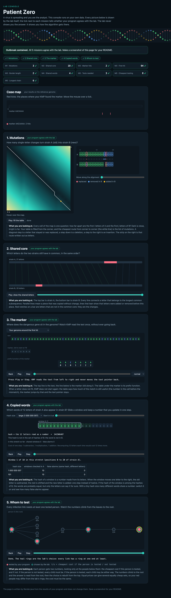

# Assignment 4. Patient Zero

Student ID: 253160
Name: Arslan Kozhabekov
Group: SE-2536
GitHub: 7exterminator

Task: `docs/Assignment4.pdf`. Code is in `src`. Data for ID 253160 is in `data`.

## Program output

The 9 lines of `java -cp out Main` on my data:

    Mutations: 107
    Shared core: 1006
    Marker hits: 6
    First hit: 4315
    Border length: 4
    Shared words: 305
    Tests needed: 41
    Cheapest testing: 168
    Longest chain: 36

My outbreak report (screenshot of `output/outbreak.html`):

## Questions

Mission 1. What does the cell d[i][j] of your table mean, and how is it computed from other cells?

d[i][j] is the smallest number of changes that turn the first i letters of A into the first j letters of B. First row: d[0][j] = j (insert j letters). First column: d[i][0] = i (delete i letters). Other cells: the smallest of three. Replace: d[i-1][j-1], plus 1 if the letters differ, plus 0 if they are equal. Delete: d[i-1][j] + 1. Insert: d[i][j-1] + 1. The answer is the last cell.

Mission 2. How is the longest common subsequence different from the longest common substring? My Shared core is bigger than the number of letters that are the same at the same place: why?

A substring must be one piece, letters next to each other. A subsequence may skip letters, only the order must stay. In my data 318 letters are equal at the same place, but Shared core is 1006. After one insert or delete the strains are shifted, so the same letters sit at different places, and the subsequence still counts them.

Mission 3. What does the prefix function tell you, and why does the pointer in the text never go back in KMP? What is the Border length of my marker and what does it mean?

pi[i] is the length of the longest proper prefix of marker[0..i] that is also its suffix. On a mismatch, pi says how many letters of the marker still match, so I move the marker pointer k back to pi[k-1] and do not read the text again. Only k goes back, the text pointer i only goes forward. Total work is O(n). My marker is GACGTAGACG and the Border length is 4: GACG is at the start and at the end. It means that two hits can overlap by 4 letters, the next hit can start 6 letters after the last one. After a full match KMP goes to k = 4, not to 0.

Mission 4. Why must you compare the letters after the hashes are equal? What happens to the cost of Rabin-Karp if many windows have the same hash?

Two different words can have the same hash (collision). Equal hash does not prove equal words, so without the comparison I would count words that are not in B. If many windows have the same hash, every lookup needs many letter comparisons of k letters. The time grows from O(n) towards O(n * k).

Mission 5. What are the two states of a person in your DP, and how do you get the answer for a person from its children? Why does a greedy "test the person with most links first" not always give the cheapest answer?

take[v] is the cheapest cost of the subtree of v when v is tested. skip[v] is the cheapest cost when v is not tested. take[v] = cost[v] + sum of min(take[c], skip[c]) over children c. skip[v] = sum of take[c] over children, because if v is not tested, every child must be tested to cover the link. The answer is min(take[0], skip[0]). To find who is tested, I go from the root down: a child of a not tested person is tested, otherwise the child takes the cheaper state. Greedy fails on costs: a person with 3 links and cost 10, and 3 leaves with cost 1 each. Greedy tests the person (cost 10), but testing the 3 leaves costs 3.

## AI use

Claude (Anthropic) reviewed the code and the README.

## Timing (Mission 7)

Milliseconds, average of 3 runs, from `java -cp out Bench`.

| test | size | time |
|---|---|---|
| naive search | 20 000 / 40 000 / 80 000 | XX / XX / XX |
| KMP | 20 000 / 40 000 / 80 000 | XX / XX / XX |
| edit distance | 500 / 1000 / 2000 / 4000 | XX / XX / XX / XX |

The pattern has fixed length, so naive search and KMP both grow about 2 times when the text is 2 times longer. Naive search is much slower, because it makes about m steps at every position, KMP makes about 1. Edit distance grows about 4 times when the length is 2 times bigger, because the table has n * n cells. Small sizes are noisy because Java is still warming up.

## Complexity

n is the length of the text (or of a strain), m the length of the pattern, k the length of the window, v the number of people.

| algorithm | time | space | assumptions |
|---|---|---|---|
| Edit distance | O(n * m) | O(n * m) | Full table, one cell in O(1). Two rows would give O(min(n, m)) space. |
| LCS | O(n * m) | O(n * m) | Same table as edit distance. |
| Prefix function and KMP | O(n + m) | O(m) | Prefix function O(m), search O(n). k goes back at most as much as it went forward. |
| Rabin-Karp (shared words) | O(n + m) on average, O(n * k) worst case | O(m) | Rolling hash is O(1) per window. k = 12 is fixed. Worst case: many equal hashes, then every window compares letters. |
| Tree DP | O(v) | O(v) | Every person is visited once (BFS order), every link twice. |
